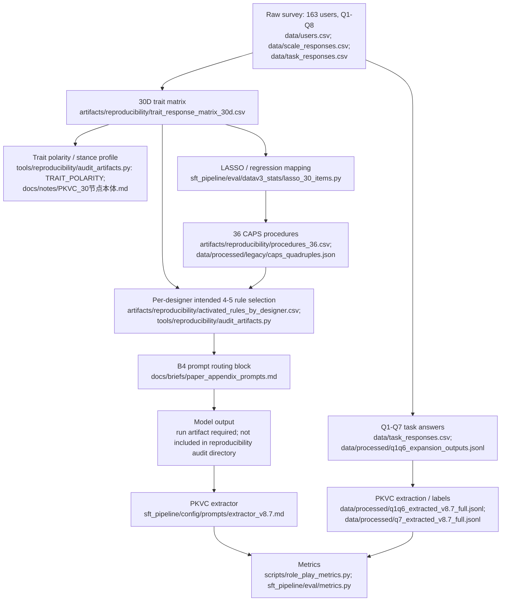

# Reproducibility Pipeline

This document maps the paper's method pipeline to the locally available
public-safe source files and generated audit artifacts. It reports what is
currently evidenced by those files; it does not claim that absent run outputs
or human-validation materials exist.

## Pipeline Diagram

All paths inside the diagram are relative to `release/public_repo/`, except
for `artifacts/reproducibility/` and `tools/reproducibility/`, which are
relative to the repository root.

## Provenance

| Stage | Input | Transformation | Output | File(s) | Current status | Reviewer risk |
| --- | --- | --- | --- | --- | --- | --- |
| Survey collection | 163 anonymized participant records and Q1-Q8 responses | Public-safe release packaging | User, scale, and task response tables | `release/public_repo/data/users.csv`; `release/public_repo/data/scale_responses.csv`; `release/public_repo/data/task_responses.csv` | Existing source tables | The raw survey instrument and all Q8-specific downstream uses are not enumerated in the audit artifacts. |
| Trait matrix | Long-form scale responses | Pivot 30 questionnaire nodes by anonymized user ID; flag users with Q7 extraction records | 163 x 30 trait matrix plus `has_q7_gold` | `artifacts/reproducibility/trait_response_matrix_30d.csv`; `tools/reproducibility/audit_artifacts.py` | Existing generated artifact: 163 designers, 30 trait dimensions | The CSV adds a Q7-coverage flag; it is not itself an independent human-gold indicator. |
| Stance profile | Trait scores and locked ontology | Map high/low score polarity to stance labels | Prompt-ready stance profile | `release/public_repo/docs/notes/PKVC_30节点本体.md`; `tools/reproducibility/audit_artifacts.py` (`TRAIT_POLARITY`) | Source mapping exists | The audit generator contains a transcription of the ontology; reviewers should compare it against the ontology document when changing labels. |
| Q1-Q7 task material | Task responses and Q1-Q6 expansions | Structured-answer preparation and PKVC extraction | Q1-Q6 and Q7 PKVC label records | `release/public_repo/data/task_responses.csv`; `release/public_repo/data/processed/q1q6_extracted_v8.7_full.jsonl`; `release/public_repo/data/processed/q7_extracted_v8.7_full.jsonl` | Existing source outputs | Extracted labels are model-assisted unless separately supported by human annotation evidence. |
| Trait-to-state mapping | Trait matrix and extracted behavior labels | LASSO/regression analysis; compiled mapping retained as legacy procedure data | CAPS candidate/procedure mapping | `release/public_repo/sft_pipeline/eval/datav3_stats/lasso_30_items.py`; `release/public_repo/data/processed/legacy/caps_quadruples.json` | Procedure output exists; fitting run artifacts are not included here | Coefficients can be inspected, but the audit directory does not contain a full rerun log, tuning record, or model diagnostic report. |
| CAPS procedures | Compiled CAPS quadruples | Normalize the 36 procedures to a CSV table | 36 procedure rows | `artifacts/reproducibility/procedures_36.csv`; `release/public_repo/data/processed/legacy/caps_quadruples.json` | Existing generated artifact: 36 rows | The table is a compiled mapping, not a substitute for all regression provenance. |
| Per-designer activation | Trait score row and CAPS procedures | Apply score-polarity activation, select top active rule per PKVC class, then add one non-duplicate global top rule | Active routed-rule table | `artifacts/reproducibility/activated_rules_by_designer.csv`; `tools/reproducibility/audit_artifacts.py` | Existing generated artifact: 644 rows for 163 designers | “4-5” is the intended prompt selection rule. In the current table, 155 designers have 4 active rules and 8 have 3; no designer has 5 because the global top duplicates a class top or a class has no active procedure. |
| B4 prompt routing | Stance/profile blocks, Q3-Q6 behavior, active CAPS rules, Q7 segment prompt | Compose system and user prompt blocks | B4/v2-anchor prompt specification | `release/public_repo/docs/briefs/paper_appendix_prompts.md` | Prompt specification exists | A prompt specification is not a saved inference manifest; exact production inputs, model settings, and outputs need run-level capture. |
| Model generation | Routed prompt and selected model | Inference | Generated response per Q7 segment | Inference scripts under `release/public_repo/scripts/`; run artifact not present in `artifacts/reproducibility/` | Gap in current audit package | No generated-output file is linked here, so output-level reproduction cannot be checked from this package alone. |
| Output extraction and metrics | Generated response and held-out Q7 labels | PKVC extraction followed by evaluation metrics | Extracted prediction labels and metric reports | `release/public_repo/sft_pipeline/config/prompts/extractor_v8.7.md`; `release/public_repo/scripts/role_play_metrics.py`; `release/public_repo/sft_pipeline/eval/metrics.py` | Implementations exist; corresponding audited run reports are not included here | Using a model extractor, especially if it overlaps with an evaluated backbone, can introduce extractor bias; human-only validation remains necessary. |

## Evidence Gaps And Interpretation

- Q7 extractor labels exist for 162 designers x 3 segments (486 segment labels), as indicated by the `has_q7_gold` coverage flag in the trait matrix and the Q7 extracted-label source.
- The full 163 x 30 trait matrix exists in `artifacts/reproducibility/trait_response_matrix_30d.csv`.
- The 36 CAPS procedures exist in `artifacts/reproducibility/procedures_36.csv`.
- Per-designer activated rules are derivable and are generated in `artifacts/reproducibility/activated_rules_by_designer.csv`. The prompt specification intends a 4-5-rule selection, but the active-rule predicate can leave a PKVC class without an eligible rule. The current artifact therefore has 155 designers with 4 active rules and 8 with 3 active rules, rather than a universal 4-5 observed count.
- Expert human-gold evidence in the current local files covers only 5 users x 3 segments (15 segments). No inter-annotator-agreement (IAA) file was found. This is inadequate to establish annotator reliability for the full 486-segment extractor-label corpus.
- The generated audit package includes inputs and compiled mappings, but not a model-output manifest or the metric reports from a specific B4 inference run. Those materials are needed for end-to-end rerun verification.
